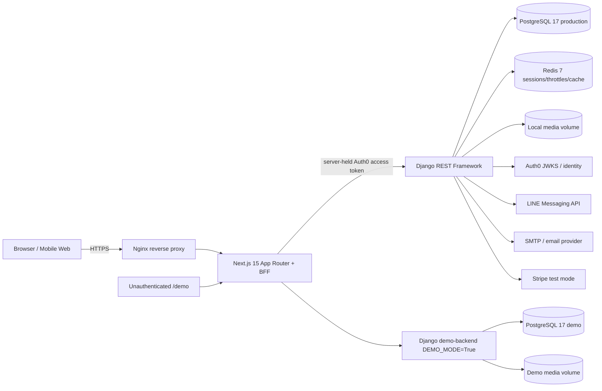
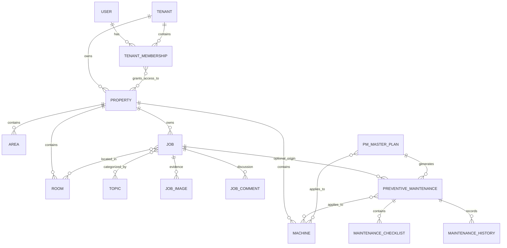

# StayMaint System Architecture Audit

> ขอบเขตเวลา: รายงานนี้บันทึก audit baseline ก่อนงานปรับปรุง Demo ใน commit นี้ จึงไม่ใช่สถานะล่าสุดของฟีเจอร์ Demo ทุกส่วน
>
> แก้ไขข้อค้นพบ scheduler: `backend/myLubd/entrypoint.sh` มี cron สำหรับ PM LINE reminders (09:00), daily summary (23:00) และ Demo reset ทุก 30 นาทีอยู่แล้ว ข้อความด้านล่างที่กล่าวว่าไม่พบ scheduler ให้ตีความว่า **ยังไม่ยืนยันผลการรันจริงและยังไม่พบ schedule สำหรับ PM master-plan materialization** ไม่ใช่ไม่มี cron. `scripts/backup.sh` มีอยู่ แต่ target `docker exec backend` ต่างจากชื่อ container ที่ตรวจพบ (`django-backend`); การสำรองตามเวลาและ restore ยัง NOT VERIFIED.

วันที่ตรวจ: 5 พฤศจิกายน 2026  
ขอบเขต: source, configuration, tests และ read-only runtime checks ของ repository ปัจจุบัน

## VERIFIED FACTS

| Layer | ผลตรวจ | หลักฐาน |
|---|---|---|
| Frontend | Next.js 15.5.9, React 18.3.1, TypeScript 5.9.2, App Router | `frontend/Lastnext/package.json`; runtime version check |
| Backend | Django 4.2.30, Django REST Framework 3.17.2 | `backend/myLubd/requirements.txt`; runtime import check |
| Database | PostgreSQL 17; production และ public demo แยก database/volume | `docker-compose.yml` services `db`, `db-demo`, `backend`, `demo-backend` |
| Cache/session | Redis 7 AOF; frontend ใช้ opaque Auth0 session reference และ server-side session store | `docker-compose.yml`; `frontend/Lastnext/middleware.ts`; `app/api/v1/[...path]/route.ts` |
| Authentication | Auth0 OIDC/JWT; backend ตรวจ RS256 signature, issuer, audience, expiry และ bind `(issuer, subject)` ผ่าน `AuthIdentity` | `myappLubd/auth.py::Auth0JWTAuthentication`; `models.py::AuthIdentity` |
| Authorization | `TenantMembership` roles + property grants; canonical scope ผ่าน `get_accessible_properties()` / `get_operable_properties()` | `models.py::TenantMembership`; `tenancy.py` |
| API | REST API ภายใต้ `/api/v1/`; browser ผ่าน Next.js BFF ซึ่งลบ browser Authorization และใส่ server token | `myappLubd/urls.py`; `app/api/v1/[...path]/route.ts` |
| Media | Django filesystem media volume; image optimization เป็น JPEG; ไม่มี object storage ที่ตรวจพบ | `settings.py`; `models.py::JobImage`; `docker-compose.yml` volumes |
| Background work | Django management commands สำหรับ PM materialization, reminders, summaries; ไม่พบ Celery/worker/scheduler service | `management/commands/`; `docker-compose.yml` |
| Email | SMTP backend และ summary/invitation commands/templates มีอยู่; runtime Gmail OAuth variables/recipient list ว่าง | `settings.py`; compose runtime warnings; `management/commands/send_daily_summary.py` |
| Notifications | LINE webhook/property binding, LINE job events, durable PM reminder batch/delivery; Web Push models/helpers | `notifications/`; `signals.py`; `models.py::PushSubscription` |
| Deployment | Docker Compose: Nginx, Next.js, Django, Redis, PostgreSQL, isolated demo stack | `docker-compose.yml` |
| HTTPS/proxy | Nginx redirects HTTP→HTTPS, TLS 1.2/1.3, HSTS/security headers, static/media aliases | `nginx/conf.d/staymaint.com.ssl.conf` |
| CI | GitHub Actions runs frontend typecheck/lint/tests; backend migration/check and a limited canonical-property test subset | `.github/workflows/ci.yml` |
| Logging | Console logging only; ไม่พบ Sentry/APM/Prometheus/OpenTelemetry integration | `settings.py::LOGGING`; repository search |

Runtime ณ เวลาตรวจ: `db`, `db-demo`, `backend`, `demo-backend`, `frontend`, `nginx`, `redis` แสดงสถานะ `healthy`; `/api/health/` ตอบ `{"status":"ok"}`; `manage.py check --deploy` ผ่าน และ migrations ถึง `myappLubd.0096_pending_job_image` ถูก apply แล้วทั้งหมด

## Architecture diagram

## Domain relationship ที่ยืนยันได้

- “Organization” ใน product model ตรงกับ `Tenant` ไม่ใช่ Django Group.
- `Job.property` และ `Room.property` เป็น non-null canonical ownership boundary (`migrations/0072`–`0076`).
- `PreventiveMaintenance` อาจผูก `Job` หรือ `PMMasterPlan` และ/หรือ `Machine`; จึงไม่ใช่ทุก PM ที่มี Job. Runtime พบ PM ที่ไม่มี Job 78 รายการ แต่ไม่พบ PM ที่ผูก machines ข้าม property หรือขัดกับ Job property.
- Reports เป็น computed/API/UI projection ไม่ใช่ entity ที่ต่อจาก Job โดยตรง ยกเว้น `WorkspaceReport` ซึ่งเป็นอีก model และไม่ใช่ jobs-report หลัก.

## Canonical property runtime audit (aggregate only)

| Check | Result |
|---|---:|
| Job ↔ Room property mismatch | 0 |
| Job ↔ Area property mismatch | 0 |
| PM Job ↔ Machine property mismatch | 0 |
| PM machine sets spanning multiple properties | 0 |
| InventoryUsage ↔ Job property mismatch | 0 |
| InventoryUsage ↔ PM Job property mismatch | 0 |

ไม่มีชื่อผู้ใช้ แขก ห้อง หรือ credential ถูกนำออกจาก runtime ในการตรวจนี้

## UNVERIFIED ITEMS

- External Auth0, LINE, SMTP และ Stripe end-to-end delivery ไม่ได้ทดสอบ
- Scheduled execution ของ management commands (cron/systemd/external scheduler) ไม่พบใน repository
- Backup restore และ disaster recovery ไม่ได้ทดสอบ
- Horizontal scaling/shared-media behavior ไม่ได้ทดสอบ

## RISKS

- Local media volume เป็น single-host dependency และไม่มี verified off-site backup/object storage.
- Auth0 JWKS ถูก fetch ใน authentication path (`auth.py::_validate_auth0_token`) โดยไม่พบ cache; provider/network latency อาจกระทบทุก API authentication.
- `limit_req_zone` ถูกประกาศใน `nginx/conf.d/00-global-limits.conf` แต่ไม่พบ `limit_req` ที่นำ zone ไปใช้กับ routes ทั่วไป.
- Management commands มี logic ที่ดี แต่ไม่มี scheduler service ที่พิสูจน์ว่า PM generation/reminders ทำงานอัตโนมัติ.

## RECOMMENDATIONS

1. ทำ architecture decision record สำหรับ canonical Tenant/Property boundary และ PM ownership.
2. เพิ่ม scheduler/worker ที่มี retry, locking, alert และ runbook.
3. ย้าย media ไป managed object storage พร้อม lifecycle/backup.
4. cache JWKS ตาม `Cache-Control`/key rotation และ monitor provider failures.
5. เพิ่ม centralized structured logging, error tracking และ metrics/alerts.
